<!-- ============================================================
  GitHub Profile README — kvik0802 (Naini Vivekanand)
  GitSkins "Recruiter-ready" template (satan theme) + enhanced
  animations, pixel art, and games.
============================================================= -->

<b>AI/ML Engineer · LLM Systems · Evaluation · Computer Vision</b>

 

## About

> Building useful things and learning in public.

- 👥 **0** followers · **1** following
- 📍 Hyderabad, India
- 📧 nainiv750@gmail.com · 📞 +91 72889 45374

*Small, useful work over vague claims.*

## Core toolkit

  

  

## Selected work

  

### 🧠 AIRA — Autonomous AI Agent System
Multi-provider agent system with structured outputs, function calling, and health-scored failover. Self-learning loop with auto LoRA fine-tuning (Unsloth, GGUF, Ollama). 800+ tests.
[View repo →](https://github.com/kvik0802/aira-brainos-core)

### 🛡️ Agent Guardian
Real-time AI safety middleware — risk scoring, human-in-the-loop approval, rollback, and observability dashboards.
[View repo →](https://github.com/kvik0802/agent-guardian)

### 🔍 OmniQuery NL2SQL Agent
NL-to-SQL analytics agent with schema graphs, SQL AST guardrails (SQLGlot), and auto-visualizations.
[View repo →](https://github.com/kvik0802/OmniQuery-NL2SQL-Agent)

### 📊 RL-EvalBench
Frontier RL environment & dynamic verification engine for LLM agents (sub-ms latency, RSS profiling via psutil).
[View repo →](https://github.com/kvik0802/RL-EvalBench)

### 🧠 Qwen2.5-7B Elastic MoE · 📄 TwistText · 📊 LLM Eval Framework
*Private repos — available on request.*

## Let’s connect

  

  
  
  

  <a href="https://github.com/kvik0802">GitHub</a> ·
  <a href="https://www.linkedin.com/in/naini-vivekanand-769912215/">LinkedIn</a> ·
  <a href="mailto:nainiv750@gmail.com">nainiv750@gmail.com</a>

## Activity

  

## 🎮 Games & Animations

  <picture>
    <source media="(prefers-color-scheme: dark)" srcset="https://raw.githubusercontent.com/kvik0802/kvik0802/output/pacman-contribution-graph-dark.svg" />
    <source media="(prefers-color-scheme: light)" srcset="https://raw.githubusercontent.com/kvik0802/kvik0802/output/pacman-contribution-graph.svg" />
    
  </picture>

  

Naini Vivekanand · AI/ML Engineer · <a href="https://www.gitskins.com/readme-generator?template=community-recruiter-ready-danv">Recruiter-ready</a> template by <a href="https://www.gitskins.com/creators/itzz-shantanu">@itzz-shantanu</a>, a remix of <a href="https://www.gitskins.com/readme-generator?template=recruiter">Recruiter-ready</a> by GitSkins · enhanced with animations, pixel art & games

