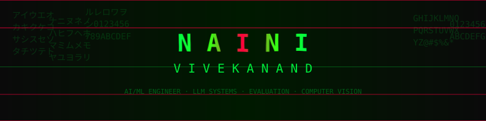

<!-- ============================================================
  GitHub Profile README — kvik0802 (Naini Vivekanand)
  Matrix Glitch theme. Local banner only. No external image deps.
============================================================= -->

<div align="center">



</div>

<br/>

```
[ SYSTEM ONLINE ]  [ MATRIX MODE: ACTIVE ]  [ STATUS: OPEN TO WORK ]
```

<p align="center">
  <code>AI/ML Engineer · LLM Systems · Evaluation · Computer Vision</code>
</p>

<br/>

---

## `> whoami`

I'm an **AI/ML Engineer** focused on building and shipping production AI agents and RAG systems. I work across the full stack — from prompt and workflow design, through evaluation, to production deployment.

Currently an **AI/ML Software Engineer Intern at PM Accelerator**, building the backend ML and OCR extraction pipeline for **TwistText** — an AI document intelligence platform processing Texas SNAP documents. The system achieves **96%+ OCR field survival**, **0.94 character F1**, and **sub-1.2s end-to-end latency** with real-time camera quality heuristics.

Previously a **Data Science Intern at Cognifyz Technologies**, working on EDA, ML model development, and data visualization.

---

## `> cat skills.txt`

```
┌─────────────────────────────────────────────────────────────────┐
│  ML / CV / COMPRESSION                                          │
│  PyTorch · scikit-learn · OpenCV · Tesseract/PaddleOCR           │
│  Hugging Face · LoRA/PEFT · Unsloth · MoE · GGUF quantization   │
│                                                                 │
│  LLM APPLICATIONS & RAG                                         │
│  LangChain · LangGraph · LlamaIndex · RAG · hybrid search        │
│  reranking · embeddings · Pinecone · Weaviate · pgvector          │
│  prompt engineering · MCP · structured outputs                   │
│                                                                 │
│  EVALUATION                                                      │
│  F1 / Precision / Recall · LLM-as-Judge · Groundedness           │
│  Regression Testing · Error Analysis · Precision@k                │
│                                                                 │
│  ENGINEERING                                                     │
│  Python · TypeScript · SQL · Rust · FastAPI · Docker             │
│  Kubernetes · GitHub Actions · CI/CD · AWS · GCP · Azure          │
│  latency & memory profiling                                      │
└─────────────────────────────────────────────────────────────────┘
```

---

## `> ls projects/`

| Project | What it does | Stack |
|---|---|---|
| **AIRA** | Autonomous multi-provider agent system with self-learning loop and 800+ tests | Python, FastAPI, Ollama |
| **Agent Guardian** | AI safety middleware — risk scoring, human approval, rollback, dashboards | FastAPI, GPT-4o-mini, Next.js |
| **OmniQuery** | NL-to-SQL analytics agent with schema graphs and SQL AST guardrails | LangGraph, SQLGlot |
| **RL-EvalBench** | Frontier RL environment & verification engine (sub-ms latency, RSS profiling) | Python, Gymnasium, psutil |
| **Neuromorphic Synapse Memory** | Zero-forgetting continual learning + complexity/proof-theory benchmarks | PyTorch, CUDA |
| **TwistText** *(private)* | Texas SNAP doc processing: 96%+ OCR survival, 0.94 char F1, <1.2s latency | FastAPI, OCR, LLMs, RAG |
| **Qwen2.5-7B Elastic MoE** *(private)* | Elastic MoE router + recursive self-learning, GGUF quantization | PyTorch, MoE, LoRA |
| **LLM Eval Framework** *(private)* | Execution-based + LLM-judge harness, CI quality gate | Python, GitHub Actions |

**Links (public repos):**
[AIRA](https://github.com/kvik0802/aira-brainos-core) · [Agent Guardian](https://github.com/kvik0802/agent-guardian) · [OmniQuery](https://github.com/kvik0802/OmniQuery-NL2SQL-Agent) · [RL-EvalBench](https://github.com/kvik0802/RL-EvalBench) · [Neuromorphic Synapse Memory](https://github.com/kvik0802/neuromorphic-synapse-memory)

---

## `> git log --oneline`

**AI/ML Software Engineer Intern** — PM Accelerator *(Present)*
- Built the backend ML & OCR extraction pipeline for TwistText: real-time camera quality heuristics, 96%+ OCR field survival, 0.94 char F1
- Engineered FastAPI microservices for document parsing, bounding-box alignment, async LLM inference (<1.2s latency, full test coverage)

**Data Science Intern** — Cognifyz Technologies *(04/2026 – 07/2026)*
- Cleaned and explored real-world datasets, built ML models with pandas and scikit-learn, created stakeholder-ready visualizations

---

## `> cat education.txt`

- **B.Tech, CSE (AI & ML)** — Neil Gogte Institute of Technology, Hyderabad (2020–2024)
- **Data Science & Generative AI** — Innomatics Research Labs, Hyderabad (2026)
- **Certifications**: Claude 101 (Anthropic) · AI Fluency Framework (Anthropic) · EDA · Power BI · Machine Learning (Innomatics)
- **Languages**: English · Telugu · Hindi · German · Spanish

---

## `> cat contact.txt`

```
email    : nainiv750@gmail.com
phone    : +91 72889 45374
github   : github.com/kvik0802
linkedin : linkedin.com/in/naini-vivekanand-769912215
location : Hyderabad, India
status   : open to AI/ML Engineer roles
```

---

<div align="center">

*Open to AI/ML Engineer roles — let's build something great.*

</div>
